<div align="center">
  
</div>

<br/>

<div align="center">
  
</div>

<br/>

<div align="center">
  
</div>

<br/>

---

### 👋 About Me

```python
class ATSDopi:
    def __init__(self):
        self.name = "ATS-Dopi"
        self.role = "Cybersecurity Student"
        self.current_project = "CTF Toolbox"
        self.languages = ["Python", "TypeScript", "JavaScript", "C", "C++",
                          "C#", "Java", "PHP", "Rust", "Swift", "Kotlin"]
        self.web = ["HTML5", "React", "Next.js", "Node.js", "Electron",
                    "WordPress", "Android"]
        self.databases = ["MySQL", "PostgreSQL", "Firebase"]
        self.tools = ["Docker", "PowerShell", "Figma", "Photoshop",
                       "Lightroom", "After Effects", "Arduino"]
        self.interests = ["CTF", "OSINT", "Pentest", "Reverse Engineering",
                          "LLM", "Automation"]
        self.location = "France"
        self.hub = "https://guns.lol/atsdopi"
        self.profile_readme = "100% self-generated — zero external services"
```

- 🎓 **Cybersecurity Student** based in France
- 🔨 Currently building a **CTF Toolbox** — a collection of tools for Capture The Flag competitions
- 🌱 Always learning: **Offensive Security**, **Reverse Engineering** & **LLM Agents**
- 💬 Ask me about **Python, TypeScript, Backend architecture, CTF challenges**
- ⚡ Fun fact: *I turn coffee into commits, and commits into trophies 🏆*

---

### 🛠️ Tech Stack

<div align="center">
  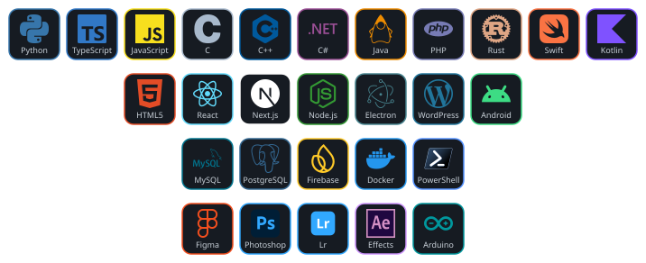
</div>

<br/>

---

### 📂 Featured Projects

<!-- Cards mirror the pinned repos — regenerated daily.
     Matching <a> snippet: assets/projects-fragment.html -->

<div align="center">
  <a href="https://github.com/ATSDopi/Auto-Desk">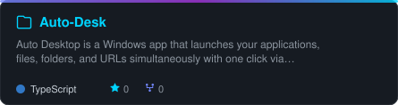</a>
  <a href="https://github.com/ATSDopi/ATS-Mail-Sorter">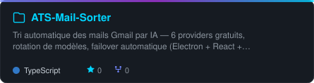</a>
  <a href="https://github.com/ATSDopi/TheStudentRepo">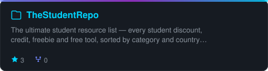</a>
  <a href="https://github.com/ATSDopi/HeadSeaker">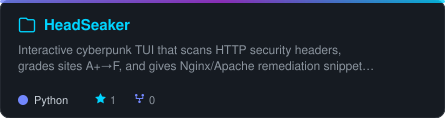</a>
</div>

<br/>

---

### 📊 GitHub Stats

<div align="center">
  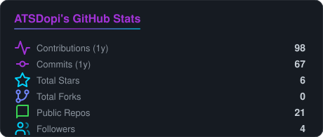
  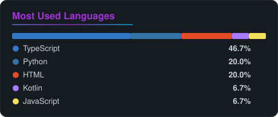
</div>

<br/>

<div align="center">
  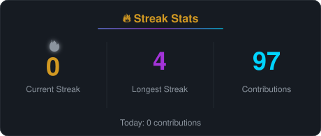
</div>

<br/>

---

### 🏆 Trophies

<div align="center">
  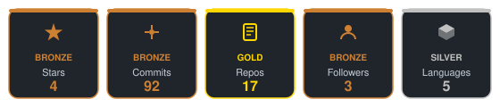
</div>

<br/>

---

### ⚡ Recent Activity

<div align="center">
  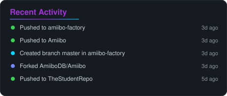
</div>

<br/>

---

### 📈 Activity Graph

<div align="center">
  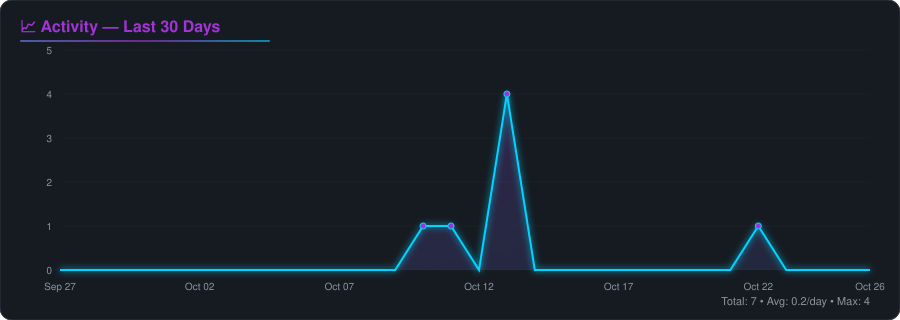
</div>

<br/>

---

### 📅 Commit Activity

<div align="center">
  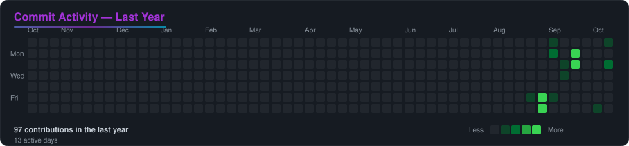
</div>

<br/>

---

### 🎮 Pac-Man ate my commits

<div align="center">
  
</div>

<br/>

---

<div align="center">
  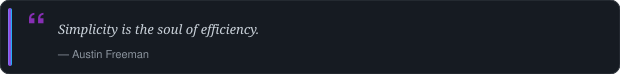
</div>

<br/>

---

### 🔗 Find Me Everywhere

> 🌐 **Central hub**: [guns.lol/atsdopi](https://guns.lol/atsdopi) — all my links in one place

<div align="center">
  <a href="https://guns.lol/atsdopi"></a>
  <a href="https://discord.com/users/704717426729943070"></a>
  <a href="https://instagram.com/0._ats_.0"></a>
  <a href="https://www.frostapp.net/"></a>
  <a href="https://www.atspro.fr/"></a>
  <a href="mailto:atsprofessional67@gmail.com"></a>
  <a href="https://www.potiongang.fr/"></a>
  <a href="https://buymeacoffee.com/ats_dopi"></a>
</div>

<br/>

---

<div align="center">
  
</div>

---

<details>
<summary>🔧 How this profile works</summary>

<br/>

**Every SVG on this page is self-generated** — no external services, no third-party badge hosts, no rate-limited APIs. Pure Python + GitHub data.

The `tools/` directory contains Python scripts that:

1. Fetch real data from the GitHub API (REST + GraphQL): contribution calendar, pinned repos, public events, aggregated stats
2. Render SVG cards — including SMIL animations (typing effect, waves, animated Pac-Man)
3. Run daily via GitHub Actions (`.github/workflows/generate-assets.yml`)

| Asset | Source | Generated by |
| --- | --- | --- |
| `banner.svg` / `footer.svg` | static | `generate_banner.py` |
| `typing.svg` | static | `generate_typing.py` |
| `badges.svg` | static | `generate_badges.py` |
| `skills.svg` | static (real brand paths) | `generate_skills.py` |
| `social-*.svg` | static | `generate_socials.py` |
| `quote.svg` | daily rotation | `generate_quote.py` |
| `stats.svg` / `top-langs.svg` | REST + GraphQL | `generate_stats.py` |
| `streak.svg` | contribution calendar | `generate_streak.py` |
| `trophies.svg` | real counters | `generate_trophies.py` |
| `activity-graph.svg` | contribution calendar | `generate_activity.py` |
| `contributions.svg` | contribution calendar | `generate_contributions.py` |
| `pacman.svg` | contribution calendar | `generate_pacman.py` |
| `feed.svg` | public events | `generate_feed.py` |
| `project-*.svg` | pinned repos | `generate_projects.py` |

To regenerate manually:

```bash
pip install -r tools/requirements.txt
GITHUB_TOKEN=<token> python tools/generate_all.py ATSDopi
```

</details>
